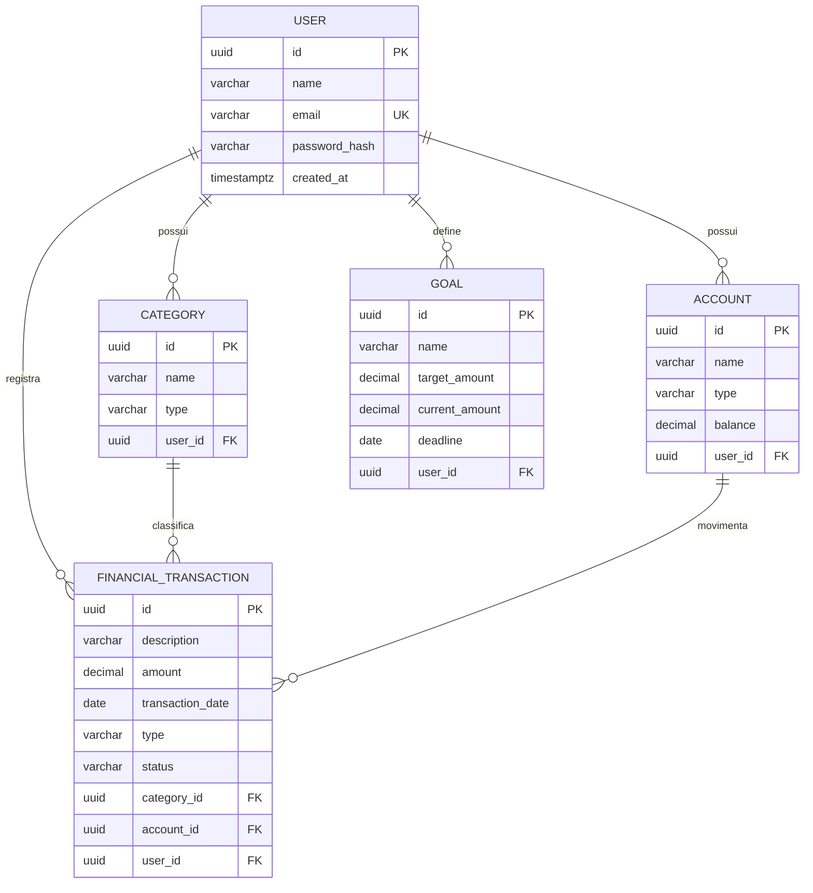

# FinAI — Finance Manager API

API REST para controle financeiro pessoal, desenvolvida em Java e Spring Boot para o CP1 da FIAP.

## 1. Problema escolhido

Muitas pessoas registram receitas, despesas, contas e metas em lugares diferentes ou simplesmente não acompanham essas informações. Isso dificulta a compreensão de para onde o dinheiro está indo, favorece atrasos em pagamentos e reduz a capacidade de planejamento.

## 2. Público-alvo

- Pessoas que desejam organizar as finanças pessoais;
- Estudantes e jovens adultos que estão começando a controlar o próprio orçamento;
- Profissionais autônomos que precisam acompanhar entradas e saídas;
- Usuários que buscam uma visão simples e centralizada da sua situação financeira.

## 3. Objetivo principal

Centralizar informações financeiras e permitir que o usuário registre, consulte e organize receitas, despesas, contas e metas. A aplicação mantém o saldo das contas atualizado e oferece uma API documentada que poderá ser consumida futuramente por aplicações web ou mobile.

## 4. Solução proposta

O **FinAI** disponibiliza uma API REST com operações CRUD para usuários, categorias, contas, transações e metas. Os dados são persistidos em PostgreSQL, validados pelas regras de negócio e documentados com Swagger/OpenAPI.

O escopo funcional do CP1 é a base da plataforma. Cartões, relatórios avançados, notificações e recursos de inteligência artificial estão previstos para as próximas etapas.

## 5. Funcionalidades do CP1

- Cadastro, listagem, consulta, atualização e exclusão de usuários;
- Categorias personalizadas de receita e despesa;
- Contas bancárias, poupança, carteira e investimentos;
- Registro de receitas e despesas;
- Consulta de transações por usuário e período;
- Situações de transação: pendente, concluída ou cancelada;
- Atualização automática do saldo quando uma transação é concluída;
- Reversão do saldo ao atualizar ou excluir uma transação concluída;
- Cadastro de metas financeiras;
- Cálculo do valor restante e do percentual de progresso;
- Validação das requisições;
- Respostas de erro padronizadas;
- Documentação interativa com Swagger UI;
- Versionamento do banco de dados com Flyway.

## 6. Regras de negócio

1. O e-mail do usuário deve ser válido e único.
2. A senha deve possuir entre 8 e 72 caracteres e é armazenada como hash BCrypt, nunca em texto puro.
3. Uma categoria pertence a um único usuário e pode ser do tipo `INCOME` ou `EXPENSE`.
4. Um usuário não pode ter duas categorias com o mesmo nome e tipo.
5. Uma conta pertence a um único usuário e seu nome deve ser único para esse usuário.
6. Valores monetários usam `BigDecimal` e duas casas decimais.
7. Toda transação deve possuir valor positivo, conta, categoria, tipo, situação e data.
8. Conta, categoria e transação devem pertencer ao mesmo usuário.
9. O tipo da transação deve ser compatível com o tipo da categoria.
10. Apenas transações `COMPLETED` alteram o saldo da conta.
11. Receitas concluídas aumentam o saldo; despesas concluídas diminuem o saldo.
12. Ao atualizar ou excluir uma transação concluída, seu efeito anterior no saldo é desfeito.
13. Categorias e contas com transações vinculadas não podem ser excluídas.
14. Um usuário com dados financeiros vinculados não pode ser excluído.
15. O valor atual de uma meta não pode ser negativo nem superior ao valor-alvo.
16. O prazo de uma meta, quando informado, não pode estar no passado.
17. Não é permitido transferir categorias, transações ou metas entre usuários durante uma atualização.

## 7. Entidades principais

| Entidade | Responsabilidade | Campos principais |
|---|---|---|
| `User` | Identifica o proprietário dos dados | id, nome, e-mail, hash da senha, data de criação |
| `Category` | Classifica receitas ou despesas | id, nome, tipo, usuário |
| `Account` | Representa uma fonte de saldo | id, nome, tipo, saldo, usuário |
| `FinancialTransaction` | Registra uma entrada ou saída | id, descrição, valor, data, tipo, situação, categoria, conta, usuário |
| `Goal` | Representa um objetivo financeiro | id, nome, valor-alvo, valor atual, prazo, usuário |

### Relacionamento entre as informações



## 8. Restrições relevantes

- Todos os identificadores usam UUID;
- O banco aplica chaves estrangeiras, unicidade e verificações de valores;
- A API recebe e responde em JSON;
- Os endpoints atuais ainda não exigem token de autenticação; JWT está no roadmap;
- Não há exclusão em cascata de dados financeiros;
- O saldo inicial só é informado na criação da conta; alterações posteriores ocorrem pelas transações;
- Este projeto é educacional e não substitui orientação financeira profissional.

## 9. Tecnologias utilizadas

- Java 21;
- Spring Boot 3.3.5;
- Spring Web;
- Spring Data JPA e Hibernate;
- Bean Validation;
- Spring Security Crypto para BCrypt;
- PostgreSQL 16;
- Flyway;
- Swagger/OpenAPI com Springdoc;
- Maven;
- JUnit 5 e AssertJ;
- Docker e Docker Compose.

## 10. Arquitetura inicial

A aplicação utiliza arquitetura em camadas para separar responsabilidades:

```text
src/main/java/br/com/finai/
├── config/          # Configurações gerais e OpenAPI
├── controller/      # Entrada HTTP e códigos de resposta
├── domain/
│   ├── entity/      # Entidades persistidas
│   └── enums/       # Tipos e situações permitidos
├── dto/             # Contratos JSON de entrada e saída
├── exception/       # Erros e tratamento global
├── repository/      # Acesso ao PostgreSQL com Spring Data JPA
└── service/         # Casos de uso e regras de negócio
```

Fluxo de uma requisição:

```text
Cliente → Controller → Service → Repository → PostgreSQL
                    ↘ tratamento global de erros
```

## 11. Banco de dados

O projeto utiliza **PostgreSQL 16**. A estrutura é criada automaticamente pelo Flyway a partir de `src/main/resources/db/migration/V1__create_core_tables.sql`.

As tabelas são `users`, `categories`, `accounts`, `financial_transactions` e `goals`.

## 12. Instalação e configuração

### Pré-requisitos

Escolha uma das opções:

- Docker Desktop com Docker Compose; ou
- JDK 21, Maven 3.9+ e PostgreSQL 16.

### Clonar o repositório

```bash
git clone https://github.com/ThayAlms/finance-manager-api.git
cd finance-manager-api
```

### Variáveis de ambiente

Copie `.env.example` para `.env` e ajuste os valores quando necessário.

| Variável | Valor padrão | Descrição |
|---|---|---|
| `DB_NAME` | `finai` | Nome do banco |
| `DB_HOST` | `localhost` | Servidor do PostgreSQL |
| `DB_PORT` | `5432` | Porta do PostgreSQL |
| `DB_USERNAME` | `finai` | Usuário do banco |
| `DB_PASSWORD` | `finai` | Senha do banco |
| `SERVER_PORT` | `8080` | Porta HTTP da API |

Nunca envie o arquivo `.env` com credenciais reais ao GitHub.

## 13. Como executar

### Opção A — API e banco com Docker

```bash
docker compose up --build
```

### Opção B — banco com Docker e API com Maven

```bash
docker compose up -d postgres
mvn spring-boot:run
```

A API responderá em `http://localhost:8080`.

Para encerrar os contêineres:

```bash
docker compose down
```

Para também apagar o volume local do banco, use `docker compose down -v` somente quando os dados puderem ser descartados.

## 14. Principais endpoints

| Método | Endpoint | Resultado esperado |
|---|---|---|
| `GET` | `/api/v1/users` | Lista usuários |
| `GET` | `/api/v1/users/{id}` | Busca um usuário |
| `POST` | `/api/v1/users` | Cria um usuário |
| `PUT` | `/api/v1/users/{id}` | Atualiza um usuário |
| `DELETE` | `/api/v1/users/{id}` | Exclui um usuário sem vínculos |
| `GET` | `/api/v1/categories?userId={uuid}` | Lista categorias do usuário |
| `GET` | `/api/v1/categories/{id}` | Busca uma categoria |
| `POST` | `/api/v1/categories` | Cria uma categoria |
| `PUT` | `/api/v1/categories/{id}` | Atualiza uma categoria |
| `DELETE` | `/api/v1/categories/{id}` | Exclui uma categoria sem transações |
| `GET` | `/api/v1/accounts?userId={uuid}` | Lista contas do usuário |
| `GET` | `/api/v1/accounts/{id}` | Busca uma conta |
| `POST` | `/api/v1/accounts` | Cria uma conta |
| `PUT` | `/api/v1/accounts/{id}` | Atualiza nome e tipo da conta |
| `DELETE` | `/api/v1/accounts/{id}` | Exclui uma conta sem transações |
| `GET` | `/api/v1/transactions?userId={uuid}&startDate={data}&endDate={data}` | Lista transações por período |
| `GET` | `/api/v1/transactions/{id}` | Busca uma transação |
| `POST` | `/api/v1/transactions` | Cria uma transação e atualiza o saldo |
| `PUT` | `/api/v1/transactions/{id}` | Atualiza a transação e recalcula o saldo |
| `DELETE` | `/api/v1/transactions/{id}` | Exclui a transação e reverte o saldo |
| `GET` | `/api/v1/goals?userId={uuid}` | Lista metas do usuário |
| `GET` | `/api/v1/goals/{id}` | Busca uma meta |
| `POST` | `/api/v1/goals` | Cria uma meta |
| `PUT` | `/api/v1/goals/{id}` | Atualiza uma meta |
| `DELETE` | `/api/v1/goals/{id}` | Exclui uma meta |

### Exemplo para demonstração

Crie primeiro um usuário:

```json
POST /api/v1/users
{
  "name": "Maria Silva",
  "email": "maria@email.com",
  "password": "Senha@123"
}
```

Use o `id` retornado para criar categoria e conta. Depois crie uma transação:

```json
POST /api/v1/transactions
{
  "description": "Compra no supermercado",
  "amount": 250.90,
  "date": "2026-09-02",
  "type": "EXPENSE",
  "status": "COMPLETED",
  "categoryId": "UUID_DA_CATEGORIA",
  "accountId": "UUID_DA_CONTA",
  "userId": "UUID_DO_USUARIO"
}
```

## 15. Códigos HTTP e erros

- `200 OK`: consulta ou atualização realizada;
- `201 Created`: recurso criado;
- `204 No Content`: exclusão realizada;
- `400 Bad Request`: JSON, parâmetro ou validação inválida;
- `404 Not Found`: recurso não encontrado;
- `409 Conflict`: regra de negócio ou integridade violada;
- `500 Internal Server Error`: falha inesperada.

Exemplo de erro padronizado:

```json
{
  "timestamp": "2026-09-02T12:00:00-03:00",
  "status": 400,
  "error": "Bad Request",
  "message": "Existem campos inválidos na requisição",
  "path": "/api/v1/users",
  "fieldErrors": {
    "email": "deve ser um endereço de e-mail bem formado"
  }
}
```

## 16. Documentação Swagger

Com a aplicação em execução:

- Swagger UI: [http://localhost:8080/swagger-ui.html](http://localhost:8080/swagger-ui.html)
- OpenAPI JSON: [http://localhost:8080/v3/api-docs](http://localhost:8080/v3/api-docs)

O Swagger permite consultar contratos, exemplos, parâmetros, respostas e executar requisições durante a apresentação.

## 17. Testes

```bash
mvn test
```

O projeto inclui testes das regras de saldo e progresso das metas, além de um teste de integração que inicializa o contexto Spring, executa a migração Flyway e valida o mapeamento JPA em banco H2 no modo PostgreSQL.

## 18. Organização do projeto

- Trello ou Notion: **[ADICIONAR LINK PÚBLICO DO QUADRO AQUI]**

Sugestão de colunas: `Backlog`, `A fazer`, `Em andamento`, `Em revisão` e `Concluído`.

## 19. Integrantes

> Substituir os itens abaixo antes da entrega.

- **[Nome completo]** — RM **[000000]**
- **[Nome completo]** — RM **[000000]**
- **[Nome completo]** — RM **[000000]**

## 20. Roteiro sugerido para apresentação do CP1

1. Contextualizar o problema e o público-alvo;
2. Explicar a solução e o escopo entregue;
3. Apresentar as regras de negócio principais;
4. Mostrar a arquitetura em camadas;
5. Explicar entidades, relacionamentos e migração do banco;
6. Abrir o Swagger e apresentar os contratos;
7. Demonstrar a criação de usuário, categoria e conta;
8. Criar uma receita ou despesa concluída;
9. Consultar a conta e comprovar a alteração automática do saldo;
10. Demonstrar uma validação com resposta de erro padronizada;
11. Mostrar o quadro do Trello ou Notion e a divisão das atividades.

## 21. Próximas etapas

- [ ] Autenticação e autorização com JWT;
- [ ] Recuperação de senha;
- [ ] Cartões, faturas, parcelamentos e recorrências;
- [ ] Dashboard e relatórios;
- [ ] Exportação em PDF e Excel;
- [ ] Lembretes e notificações;
- [ ] Classificação automática de despesas com IA;
- [ ] Previsão de gastos e saldo;
- [ ] Detecção de gastos incomuns;
- [ ] Sugestões de economia;
- [ ] Chatbot financeiro;
- [ ] Ampliação da cobertura de testes.

## 22. Licença

Projeto desenvolvido para fins acadêmicos na FIAP.
