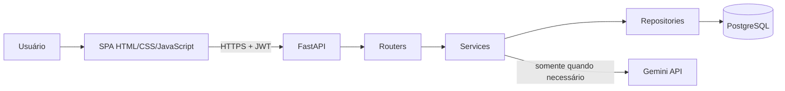
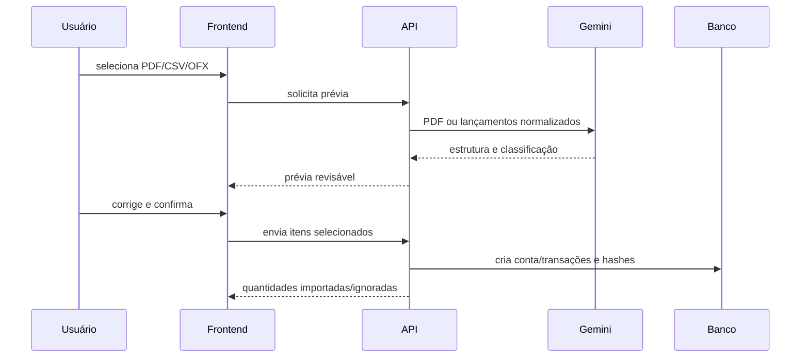

# Arquitetura do CaixaLivre

## Visão geral

O Nginx entrega a SPA. O frontend consome somente a API; não possui acesso ao
banco, à chave do Gemini ou ao segredo JWT. A API separa contratos HTTP, regras
de negócio e persistência para reduzir acoplamento e facilitar testes.

## Responsabilidades

| Camada | Responsabilidade |
|---|---|
| `frontend/` | navegação, formulários, feedback, dashboard e prévia de importação |
| `app/routers/` | rotas HTTP, autenticação requerida e response models |
| `app/schemas/` | validação dos contratos de entrada e saída |
| `app/services/` | regras de negócio, autorização contextual e integrações |
| `app/repositories/` | consultas SQLAlchemy e agregações |
| `app/models/` | entidades, enums, constraints e índices |
| `alembic/` | evolução reproduzível do schema e categorias iniciais |
| `tests/` | testes de endpoints, isolamento e regras críticas |

## Autenticação e isolamento

1. O usuário se cadastra ou envia e-mail e senha ao login.
2. O backend valida o hash BCrypt e emite um JWT com expiração.
3. O frontend envia o token no cabeçalho `Authorization: Bearer`.
4. A API obtém o usuário do token; contratos financeiros não aceitam `usuario_id`.
5. Repositories filtram contas e recursos pelo usuário autenticado.

## Dashboard

`GET /api/v1/resumo` recebe o período e executa agregações no banco. A resposta
contém totais, evolução mensal, categorias e divisão PESSOAL/NEGOCIO. Essa
decisão evita baixar todas as transações e repetir cálculos no navegador.

## Importação de extratos

Nada é persistido na prévia. O hash de data, descrição e valor, combinado com
a conta, evita importar o mesmo lançamento novamente.

## Segurança da LLM

- a chave fica somente no backend e não entra no Git;
- insights usam dados agregados;
- CSV/OFX enviam lançamentos normalizados;
- PDF exige aviso e consentimento porque o documento completo vai ao Gemini;
- senha, hash, JWT e e-mail não fazem parte dos prompts;
- timeout e tratamento de erro impedem falha em cascata;
- classificação sempre passa por revisão humana.

## Implantação local

Docker Compose inicia PostgreSQL, API e frontend. A API aguarda o banco saudável,
executa `alembic upgrade head` e inicia o Uvicorn. O mesmo repositório possui CI
para migrações, testes, sintaxe JavaScript e build do frontend.
