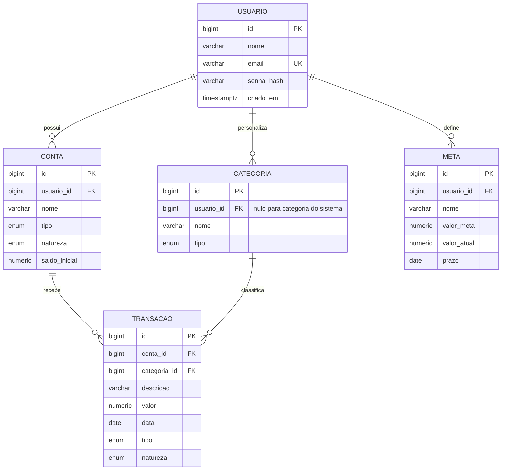

# Modelo de dados — CaixaLivre

O schema está em 3ª Forma Normal: a transação não repete `usuario_id`, pois seu proprietário é determinado pela conta. O saldo atual também não é armazenado; ele é calculado pelas transações.

## Integridade

- IDs numéricos gerados pelo PostgreSQL;
- e-mail único;
- conta única por usuário e nome;
- categoria personalizada única por usuário, nome e tipo;
- categorias do sistema únicas por nome e tipo;
- valores financeiros protegidos por `CHECK`;
- exclusão de conta ou categoria referenciada por transação é restrita;
- índices sustentam filtros por usuário, conta e período.

A definição executável está em `alembic/versions/0001_schema_inicial.py`.
