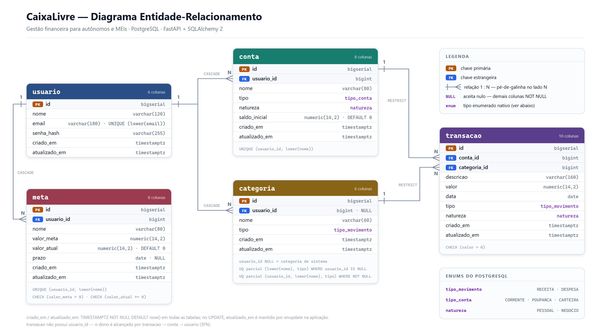

# Modelo de dados — CaixaLivre

Estrutura do banco: entidades, atributos, relacionamentos, constraints e
índices. Referência de regras: [regras-de-negocio.md](regras-de-negocio.md).

O schema está em 3ª Forma Normal: a transação não repete `usuario_id`, pois seu
proprietário é determinado pela conta. O saldo atual também não é armazenado;
ele é calculado pelas transações.

SGBD: PostgreSQL. ORM: SQLAlchemy 2. Migrations: Alembic.

O diagrama pronto está na [seção 7](#7-diagrama-der).

---

## 1. Enums

Três enums nativos do Postgres. Enum em vez de `VARCHAR` livre porque o banco
passa a rejeitar valor inválido sozinho — não depende de ninguém lembrar de validar.

| Enum | Valores | Usado em |
|---|---|---|
| `tipo_movimento` | `RECEITA`, `DESPESA` | `categoria.tipo`, `transacao.tipo` |
| `tipo_conta` | `CORRENTE`, `POUPANCA`, `CARTEIRA` | `conta.tipo` |
| `natureza` | `PESSOAL`, `NEGOCIO` | `conta.natureza`, `transacao.natureza` |

`tipo_conta` **não** tem `CARTAO_CREDITO` — restrição R03. Cartão tem fatura,
limite e fechamento; não cabe na entidade Conta. Fica para uma versão futura.

---

## 2. Entidades e atributos

### `usuario`

| Coluna | Tipo | Restrições | Observação |
|---|---|---|---|
| `id` | BIGSERIAL | PK | |
| `nome` | VARCHAR(120) | NOT NULL | |
| `email` | VARCHAR(180) | NOT NULL, único por `lower(email)` | RN02 |
| `senha_hash` | VARCHAR(255) | NOT NULL | RN03 — bcrypt, nunca em resposta |
| `criado_em` | TIMESTAMPTZ | NOT NULL, DEFAULT now() | |
| `atualizado_em` | TIMESTAMPTZ | NOT NULL, DEFAULT now() | |

**Caixa do e-mail.** `UNIQUE (email)` puro é case-sensitive: `Joao@x.com` e
`joao@x.com` entrariam como dois usuários, e a RN02 estaria furada no primeiro
cadastro descuidado. Pior, o furo é silencioso — só aparece quando alguém não
consegue logar. Por isso a unicidade é sobre `lower(email)` (seção 4), e o
service ainda grava o valor já normalizado. Ver a decisão completa em
**Caixa em nomes e e-mail**, no fim desta seção.

### `conta`

| Coluna | Tipo | Restrições | Observação |
|---|---|---|---|
| `id` | BIGSERIAL | PK | |
| `usuario_id` | BIGINT | NOT NULL, FK → usuario | RN01 |
| `nome` | VARCHAR(80) | NOT NULL | |
| `tipo` | tipo_conta | NOT NULL | |
| `natureza` | natureza | NOT NULL | RN14 |
| `saldo_inicial` | NUMERIC(14,2) | NOT NULL, DEFAULT 0 | RN07, RN17 |
| `criado_em` | TIMESTAMPTZ | NOT NULL, DEFAULT now() | |
| `atualizado_em` | TIMESTAMPTZ | NOT NULL, DEFAULT now() | |

`UNIQUE (usuario_id, lower(nome))` — o usuário não tem duas contas com o mesmo
nome, e "Nubank" não convive com "nubank".

**Não existe coluna `saldo`.** RN07: o saldo é calculado na leitura.

### `categoria`

| Coluna | Tipo | Restrições | Observação |
|---|---|---|---|
| `id` | BIGSERIAL | PK | |
| `usuario_id` | BIGINT | **NULL**, FK → usuario | NULL = de sistema (RN16) |
| `nome` | VARCHAR(60) | NOT NULL | |
| `tipo` | tipo_movimento | NOT NULL | RN05 |
| `criado_em` | TIMESTAMPTZ | NOT NULL, DEFAULT now() | |
| `atualizado_em` | TIMESTAMPTZ | NOT NULL, DEFAULT now() | |

**Armadilha da RN15.** No Postgres, `UNIQUE` trata NULL como valor distinto —
um `UNIQUE (usuario_id, nome, tipo)` **não** impediria dez categorias de sistema
chamadas "Alimentação". A solução são dois índices parciais:

```sql
CREATE UNIQUE INDEX uq_categoria_sistema
  ON categoria (lower(nome), tipo)
  WHERE usuario_id IS NULL;

CREATE UNIQUE INDEX uq_categoria_usuario
  ON categoria (usuario_id, lower(nome), tipo)
  WHERE usuario_id IS NOT NULL;
```

O `lower(nome)` é a segunda metade da RN15: sem ele, "Transporte" e
"transporte" passam como categorias diferentes e o relatório do mês racha em
duas linhas — exatamente o que a regra existe para impedir. Ver **Caixa em
nomes e e-mail**, logo abaixo.

### `transacao`

| Coluna | Tipo | Restrições | Observação |
|---|---|---|---|
| `id` | BIGSERIAL | PK | |
| `conta_id` | BIGINT | NOT NULL, FK → conta | Sem isso o saldo é impossível |
| `categoria_id` | BIGINT | NOT NULL, FK → categoria | |
| `descricao` | VARCHAR(160) | NOT NULL | |
| `valor` | NUMERIC(14,2) | NOT NULL, CHECK > 0 | RN04, RN17 |
| `data` | DATE | NOT NULL | RN13 |
| `tipo` | tipo_movimento | NOT NULL | RN05 |
| `natureza` | natureza | NOT NULL | RN14 |
| `criado_em` | TIMESTAMPTZ | NOT NULL, DEFAULT now() | |
| `atualizado_em` | TIMESTAMPTZ | NOT NULL, DEFAULT now() | |

**Não tem `usuario_id`.** Ver seção 3.

### `meta`

| Coluna | Tipo | Restrições | Observação |
|---|---|---|---|
| `id` | BIGSERIAL | PK | |
| `usuario_id` | BIGINT | NOT NULL, FK → usuario | |
| `nome` | VARCHAR(80) | NOT NULL | |
| `valor_meta` | NUMERIC(14,2) | NOT NULL, CHECK > 0 | RN11 |
| `valor_atual` | NUMERIC(14,2) | NOT NULL, DEFAULT 0, CHECK >= 0 | R07 — aporte manual |
| `prazo` | DATE | NULL | |
| `criado_em` | TIMESTAMPTZ | NOT NULL, DEFAULT now() | |
| `atualizado_em` | TIMESTAMPTZ | NOT NULL, DEFAULT now() | |

`UNIQUE (usuario_id, lower(nome))` — o usuário não tem duas metas com o mesmo
nome.

**Por que a meta ganhou essa constraint.** `conta` tem a dela e `categoria` tem
os dois índices parciais; `meta` estava sem nada, o que permitia dez "Reserva
de emergência" na mesma lista. Isso não é caso de uso: é erro de digitação ou
clique duplo no botão de salvar. O estrago é direto — o usuário fica com duas
barras de progresso pela metade e sem resposta para "quanto eu já guardei",
que é a única pergunta que a meta existe para responder. Se ele quiser duas
metas parecidas, o caminho é dar nomes diferentes ("Reserva 2026",
"Reserva do notebook"), que é o que ele vai querer ler na tela de qualquer
forma. Violação: `409`, mesmo tratamento da RN02 e da RN15.

Isso **não vira RN nova** — a numeração vai até RN17 e os códigos já estão
referenciados nos outros documentos. É decisão de modelo. Se algum dia ela for
promovida a regra numerada, o próximo número livre é RN18.

`progresso_percentual`, `valor_restante` e `atingida` **não são colunas** —
são calculados na leitura (RN11, RN12).

### Caixa em nomes e e-mail

Quatro unicidades do modelo dependem de texto digitado pelo usuário: `email`,
`categoria.nome`, `conta.nome` e `meta.nome`. No Postgres, comparação de texto
é case-sensitive, então sem tratamento `Joao@x.com` e `joao@x.com` são dois
usuários, e "Transporte" e "transporte" são duas categorias. Nas quatro, a
regra existe justamente para impedir isso.

Três saídas possíveis, e o motivo da escolhida:

| Saída | Por que não / por que sim |
|---|---|
| `CITEXT` | Resolve, mas exige `CREATE EXTENSION citext` — privilégio elevado no banco e uma migration a mais que pode falhar na máquina de outro integrante. Ainda por cima é tipo não padrão. Caro demais para o tamanho do problema. |
| Só normalizar na aplicação | Depende de todo caminho de escrita lembrar: cadastro, edição de perfil, seed, script. Um esquecimento e o duplicado já está gravado. Contradiz a própria RN02, que declara o banco como garantia real. |
| **Índice único funcional sobre `lower(...)`** | **Escolhida.** Uma linha de DDL por caso, sem extensão, e a garantia é do banco — vale inclusive para escrita que não passou pela API. |

Consequências práticas:

- **E-mail:** o service grava `lower(trim(email))`. O índice impede o duplicado;
  a normalização evita que o mesmo e-mail apareça com caixas diferentes em
  telas diferentes.
- **Nomes (`categoria`, `conta`, `meta`):** o valor é gravado **como o usuário
  digitou** — "Alimentação" tem que continuar aparecendo com maiúscula. Só a
  comparação é insensível, porque só o índice usa `lower(...)`.
- **Espaço em branco** fica com o service, que aplica `trim` na entrada. Não
  entrou no índice: `lower(btrim(nome))` tornaria a expressão mais difícil de
  ler para cobrir um caso muito mais raro que o da caixa.

### `criado_em` e `atualizado_em`

`DEFAULT now()` resolve o INSERT e não faz nada no UPDATE — sozinho, ele deixa
`atualizado_em` nascer preenchido e nunca mudar, o que é pior que não ter a
coluna: um campo que mente é consultado como se fosse verdade. A manutenção da
coluna é definida na seção 4.

---

## 3. Relacionamentos e política de exclusão

| Origem | Destino | Cardinalidade | ON DELETE | Motivo |
|---|---|---|---|---|
| `conta.usuario_id` | `usuario.id` | N:1 | CASCADE | Não há endpoint de excluir usuário |
| `categoria.usuario_id` | `usuario.id` | N:1 | CASCADE | Idem |
| `meta.usuario_id` | `usuario.id` | N:1 | CASCADE | Idem |
| `transacao.conta_id` | `conta.id` | N:1 | **RESTRICT** | RN10 |
| `transacao.categoria_id` | `categoria.id` | N:1 | **RESTRICT** | RN08 |

Leitura: um usuário tem N contas, N categorias personalizadas e N metas.
Uma conta tem N transações. Uma categoria classifica N transações.

### Por que `transacao` não tem `usuario_id`

O dono da transação é alcançável por `transacao → conta → usuario`. Repetir
`usuario_id` em `transacao` cria uma **dependência transitiva** — o valor passa
a ser determinado por `conta_id`, e isso viola a 3ª Forma Normal.

Dois motivos para não fazer:

1. **Normalização.** Violação de 3NF conhecida é dívida que só encarece: quanto
   mais código depender da coluna redundante, mais caro fica removê-la depois.
2. **Risco real de divergência.** Se alguém mover uma transação para outra conta
   e esquecer de atualizar `transacao.usuario_id`, a transação passa a pertencer
   a dois donos diferentes dependendo de por onde você consulta. É o mesmo tipo
   de bug que a RN07 evita no saldo.

Custo: a RN01 vira um join em vez de um filtro direto.

```sql
SELECT t.* FROM transacao t
JOIN conta c ON c.id = t.conta_id
WHERE c.usuario_id = :usuario_atual;
```

Com o índice `idx_conta_usuario` isso é irrelevante no volume atual.

---

## 4. Constraints e índices

### CHECK — regras garantidas pelo próprio banco

```sql
ALTER TABLE transacao ADD CONSTRAINT ck_transacao_valor_positivo
  CHECK (valor > 0);                              -- RN04

ALTER TABLE meta ADD CONSTRAINT ck_meta_valor_positivo
  CHECK (valor_meta > 0);                         -- RN11

ALTER TABLE meta ADD CONSTRAINT ck_meta_atual_nao_negativo
  CHECK (valor_atual >= 0);                       -- RN11
```

### UNIQUE — unicidade insensível a caixa

Índices únicos funcionais, não `UNIQUE` de coluna: o `UNIQUE` puro é
case-sensitive e deixaria passar `Joao@x.com` junto com `joao@x.com`. O motivo
da escolha está na seção 2, em **Caixa em nomes e e-mail**.

```sql
CREATE UNIQUE INDEX uq_usuario_email
  ON usuario (lower(email));                      -- RN02

CREATE UNIQUE INDEX uq_conta_usuario_nome
  ON conta (usuario_id, lower(nome));

CREATE UNIQUE INDEX uq_meta_usuario_nome
  ON meta (usuario_id, lower(nome));
```

Os dois índices parciais de `categoria` (RN15) estão na seção 2 — são parciais
por causa do NULL de `usuario_id`, e por isso ficam junto da explicação.

`uq_conta_usuario_nome` e `uq_meta_usuario_nome` não correspondem a nenhuma RN
numerada: são decisões de modelo, justificadas na seção 2.

### `atualizado_em` — como a coluna é mantida

`DEFAULT now()` só age no INSERT. Sem mais nada, `atualizado_em` seria igual a
`criado_em` para sempre. Duas saídas:

| Saída | Avaliação |
|---|---|
| Trigger `BEFORE UPDATE` no Postgres | Pega **toda** escrita, inclusive `psql` na mão, script de importação e migration de dados. Custa uma função PL/pgSQL mais cinco triggers na migration. |
| **`onupdate=func.now()` no SQLAlchemy** | **Escolhida.** Uma linha na definição da coluna, sem PL/pgSQL, e vale tanto para UPDATE de objeto quanto para `update()` do Core. |

Motivo: hoje **não existe caminho de escrita fora da API** — sem importação,
sem job, sem rotina administrativa. A trigger cobriria um cenário que o projeto
não tem, cobrando por isso complexidade na migration. E `onupdate` fica ao lado
da coluna no model, onde quem lê o código encontra.

Limitação assumida, para ficar registrada: UPDATE em SQL cru não dispara o
`onupdate`. Se entrar importação de extrato, job de recorrência ou qualquer
escrita fora da API, a decisão muda para trigger — e aí ela passa a valer o
preço.

A implementação fica nos models; aqui fica só a decisão.

### Índices

```sql
CREATE INDEX idx_conta_usuario      ON conta (usuario_id);
CREATE INDEX idx_categoria_usuario  ON categoria (usuario_id);
CREATE INDEX idx_meta_usuario       ON meta (usuario_id);
CREATE INDEX idx_transacao_conta_data ON transacao (conta_id, data DESC);
CREATE INDEX idx_transacao_categoria  ON transacao (categoria_id);
CREATE INDEX idx_transacao_data       ON transacao (data);
```

`idx_transacao_conta_data` é o que sustenta o filtro por período e o cálculo de
saldo (RN07) — as duas consultas mais usadas da aplicação.

### RN13 não vira CHECK

`data <= CURRENT_DATE` não pode ser CHECK: a expressão não é imutável, o
Postgres recusa. Fica no service, validada pelo Pydantic.

### RN05 — opcional, só se sobrar tempo

RN05 (tipo da transação = tipo da categoria) é uma regra entre duas tabelas.
O caminho normal é validar no service, e é isso que está previsto.

Existe uma forma de garantir no banco, com chave estrangeira composta:

```sql
ALTER TABLE categoria ADD CONSTRAINT uq_categoria_id_tipo UNIQUE (id, tipo);

ALTER TABLE transacao ADD CONSTRAINT fk_transacao_categoria_tipo
  FOREIGN KEY (categoria_id, tipo) REFERENCES categoria (id, tipo);
```

Como `transacao.tipo` precisa bater com `categoria.tipo` para a FK existir, o
banco passa a rejeitar sozinho uma despesa com categoria de receita.

É elegante e move a garantia para o banco, mas **não faça antes do resto estar
pronto** — não é obrigatório e adiciona complexidade na migration.

---

## 5. Validação: cada regra contra o modelo

Se alguma regra não tiver onde ser aplicada, o modelo está errado — não a
regra.

| Regra | Onde é garantida |
|---|---|
| RN01 — isolamento por usuário | FK `usuario_id` em conta/categoria/meta; join via conta para transação |
| RN02 — e-mail único | Índice único sobre `lower(email)` |
| RN03 — senha só como hash | Coluna `senha_hash`; ausente no schema de saída |
| RN04 — valor > 0 | `CHECK (valor > 0)` |
| RN05 — tipo transação = tipo categoria | Service (ou FK composta, opcional) |
| RN06 — posse dos vínculos | Service, comparando `conta.usuario_id` com o JWT |
| RN07 — saldo calculado | Ausência da coluna `saldo` + agregação na leitura |
| RN08 — categoria com transação | FK `ON DELETE RESTRICT` |
| RN09 — categoria de sistema imutável | Service, checando `usuario_id IS NULL` |
| RN10 — conta com transação | FK `ON DELETE RESTRICT` |
| RN11 — meta válida e progresso | `CHECK (valor_meta > 0)` + cálculo na leitura |
| RN12 — meta atingida | Cálculo na leitura |
| RN13 — sem data futura | Service / Pydantic |
| RN14 — natureza obrigatória | Coluna `natureza` NOT NULL nas duas tabelas |
| RN15 — nome de categoria único | Dois índices únicos parciais, sobre `lower(nome)` |
| RN16 — categorias de sistema | `usuario_id` anulável + seed |
| RN17 — moeda e precisão | `NUMERIC(14,2)` em todo valor |

Placar: **8 regras garantidas pelo banco, 9 pela aplicação.** A divisão é
deliberada: vai para o banco o que dá para expressar como constraint, e fica na
aplicação o que depende de contexto — dono da requisição, data de hoje,
comparação entre duas tabelas.

Duas garantias do modelo não aparecem nesta tabela porque não correspondem a
nenhuma RN: os UNIQUE de nome em `conta` e em `meta` (seção 4). São decisões de
modelo, justificadas na seção 2 — a numeração das regras vai até RN17 e não foi
mexida.

---

## 6. Seed — categorias de sistema (RN16)

Todas com `usuario_id = NULL`.

**RECEITA:** Salário · Vendas · Serviços prestados · Investimentos · Outras receitas

**DESPESA:** Alimentação · Transporte · Moradia · Saúde · Educação · Lazer ·
Assinaturas · Impostos e taxas · Ferramentas e software · Outras despesas

"Impostos e taxas" e "Ferramentas e software" existem por causa do público-alvo
(autônomos e MEIs) — são as duas categorias que um app genérico não teria.

---

## 7. Diagrama (DER)



O arquivo é `docs/der.png`. Como ler:

- Retângulo é tabela. `PK` é chave primária, `FK` é chave estrangeira.
- O pé-de-galinha fica no lado **N**: `usuario 1 ──< N conta` é "um usuário,
  várias contas".
- `CASCADE` e `RESTRICT` na linha do relacionamento são a política de exclusão
  da seção 3 — `RESTRICT` é o que sustenta a RN08 e a RN10.
- `NULL` ao lado do tipo marca coluna anulável. Só duas no modelo inteiro:
  `categoria.usuario_id` (RN16) e `meta.prazo`. Todo o resto é NOT NULL.
- O rodapé cinza de cada tabela traz o que não é coluna: UNIQUE, índices
  parciais e CHECK.
- `transacao` não tem `usuario_id` de propósito — o dono vem por
  `transacao → conta → usuario`. O motivo está na seção 3.

### DBML de origem

Serve para **regerar** o diagrama em [dbdiagram.io](https://dbdiagram.io) se o
modelo mudar: New Diagram, substituir o conteúdo do editor, Export → PNG,
salvar por cima de `docs/der.png`. A legenda, os enums e as constraints do
rodapé foram acrescentados à mão depois — o dbdiagram.io não os desenha.

Este bloco **não é a fonte da verdade do modelo**. A fonte são as seções 2 a 4;
o DBML é uma projeção delas, e é limitado: **não expressa índice parcial nem
índice funcional**. Por isso, duas correções em relação à versão anterior:

1. **`categoria` perdeu o índice `(usuario_id, nome, tipo) [unique]`.** Ele
   estava errado e contradizia a seção 2: com `usuario_id` NULL nas categorias
   de sistema, esse UNIQUE não impede duplicata nenhuma entre elas. Quem
   regerasse o diagrama a partir dele produziria um DER diferente do que está
   entregue. Como o certo são **dois** índices parciais e o DBML não sabe
   escrever `WHERE`, o índice saiu e a constraint real ficou no `Note` da
   tabela, apontando para a seção 2.
2. **Os demais UNIQUE ficaram, com `note`.** Em `usuario`, `conta` e `meta` a
   estrutura que o DBML declara está certa — é uma constraint sobre aquelas
   colunas. O que falta é a expressão `lower(...)`, que o DBML não escreve;
   então ela vai no `note`. Aqui, ao contrário da `categoria`, apagar
   esconderia informação correta.

```dbml
Enum tipo_movimento {
  RECEITA
  DESPESA
}

Enum tipo_conta {
  CORRENTE
  POUPANCA
  CARTEIRA
}

Enum natureza {
  PESSOAL
  NEGOCIO
}

Table usuario {
  id bigserial [pk]
  nome varchar(120) [not null]
  email varchar(180) [not null, unique, note: 'RN02 - unicidade sobre lower(email)']
  senha_hash varchar(255) [not null, note: 'RN03 - bcrypt']
  criado_em timestamptz [not null, default: `now()`]
  atualizado_em timestamptz [not null, default: `now()`]

  Note: 'UNIQUE real: indice funcional sobre lower(email) - ver secao 4. atualizado_em e mantido por onupdate no SQLAlchemy, nao pelo default.'
}

Table conta {
  id bigserial [pk]
  usuario_id bigint [not null]
  nome varchar(80) [not null]
  tipo tipo_conta [not null]
  natureza natureza [not null, note: 'RN14']
  saldo_inicial numeric(14,2) [not null, default: 0, note: 'RN07 - nao existe coluna saldo']
  criado_em timestamptz [not null, default: `now()`]
  atualizado_em timestamptz [not null, default: `now()`]

  Indexes {
    (usuario_id, nome) [unique, note: 'na pratica sobre lower(nome) - ver secao 4']
    usuario_id
  }
}

Table categoria {
  id bigserial [pk]
  usuario_id bigint [null, note: 'NULL = categoria de sistema (RN16)']
  nome varchar(60) [not null]
  tipo tipo_movimento [not null]
  criado_em timestamptz [not null, default: `now()`]
  atualizado_em timestamptz [not null, default: `now()`]

  Indexes {
    usuario_id
  }

  Note: 'RN15 - a unicidade sao DOIS indices parciais, que o DBML nao expressa: UNIQUE (lower(nome), tipo) WHERE usuario_id IS NULL e UNIQUE (usuario_id, lower(nome), tipo) WHERE usuario_id IS NOT NULL. Ver secao 2.'
}

Table transacao {
  id bigserial [pk]
  conta_id bigint [not null]
  categoria_id bigint [not null]
  descricao varchar(160) [not null]
  valor numeric(14,2) [not null, note: 'RN04 - CHECK valor > 0']
  data date [not null, note: 'RN13 - nao pode ser futura']
  tipo tipo_movimento [not null, note: 'RN05 - deve bater com categoria.tipo']
  natureza natureza [not null, note: 'RN14']
  criado_em timestamptz [not null, default: `now()`]
  atualizado_em timestamptz [not null, default: `now()`]

  Indexes {
    (conta_id, data)
    categoria_id
    data
  }

  Note: 'Sem usuario_id de proposito - o dono vem por conta (3FN). Ver secao 3.'
}

Table meta {
  id bigserial [pk]
  usuario_id bigint [not null]
  nome varchar(80) [not null]
  valor_meta numeric(14,2) [not null, note: 'RN11 - CHECK > 0']
  valor_atual numeric(14,2) [not null, default: 0, note: 'R07 - aporte manual']
  prazo date [null]
  criado_em timestamptz [not null, default: `now()`]
  atualizado_em timestamptz [not null, default: `now()`]

  Indexes {
    (usuario_id, nome) [unique, note: 'na pratica sobre lower(nome) - ver secao 4']
    usuario_id
  }
}

Ref: conta.usuario_id > usuario.id [delete: cascade]
Ref: categoria.usuario_id > usuario.id [delete: cascade]
Ref: meta.usuario_id > usuario.id [delete: cascade]
Ref: transacao.conta_id > conta.id [delete: restrict]
Ref: transacao.categoria_id > categoria.id [delete: restrict]
```
